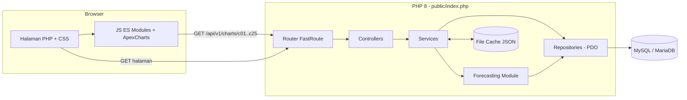

# ARCHITECTURE — EbonyCraft Palu

Dokumen arsitektur teknis. Kebutuhan ada di `PRD.md`, tampilan di `DESIGN.md`, alur kerja di `WORKFLOW.md`.

---

## 1. Ringkasan Keputusan Teknis

| Aspek | Pilihan | Alasan |
|-------|---------|--------|
| Bahasa backend | **PHP 8.2+** (native, tanpa framework berat) | Sesuai permintaan; mudah dijalankan di Laragon/XAMPP; struktur tetap rapi dan dapat dijelaskan ke dosen |
| Database | **MySQL 8 / MariaDB 10.6+** via **PDO** | Umum, mendukung agregasi dan window function |
| Frontend | HTML + **CSS custom (design tokens)** + **JavaScript ES Modules** | Tanpa langkah *build* (tidak perlu Node), ringan |
| Chart | **ApexCharts** (disalin lokal ke `public/assets/vendor/`) | Mendukung heatmap, treemap, boxplot, rangeArea, bubble, radialBar, dan mixed chart secara bawaan, sehingga 25 chart tercakup tanpa plugin tambahan |
| Prediksi | **Native PHP** (kelas `Forecasting\*`) | Tidak perlu Python; data kecil (46 titik) cukup dengan algoritma klasik yang transparan |
| Dependensi Composer | `vlucas/phpdotenv`, `nikic/fast-route`, `phpunit/phpunit` (dev) | Minimal dan stabil |
| Gaya kode | PSR-4 autoload, PSR-12, `declare(strict_types=1)` | Konsisten dan mudah diuji |

> **Alternatif:** bila dosen mengharuskan framework, struktur Controller → Service → Repository di bawah dapat dipindahkan ke Laravel tanpa mengubah desain database, endpoint, dan modul prediksi.

## 2. Arsitektur Tingkat Tinggi



**Pola:** *Server-rendered shell + JSON API*. PHP merender kerangka halaman (sidebar, filter, kartu kosong); JavaScript memanggil API per chart secara asinkron dan menggambar dengan ApexCharts. Pendekatan ini membuat tiap chart mandiri, mudah di-*cache*, dan mudah diuji.

## 3. Struktur Folder

```
ebonycraft-palu/
├─ public/                       # document root
│  ├─ index.php                  # front controller
│  └─ assets/
│     ├─ css/ (tokens.css, layout.css, components.css)
│     ├─ js/
│     │  ├─ app.js               # bootstrap, filter state
│     │  ├─ api.js               # fetch wrapper
│     │  ├─ format.js            # Intl id-ID helper
│     │  └─ charts/ (c01.js … c25.js, registry.js)
│     ├─ vendor/apexcharts.min.js
│     └─ img/
├─ src/
│  ├─ Core/        (Router, Request, Response, Database, Cache, Auth, Csrf, View)
│  ├─ Controllers/ (PageController, ChartController, KpiController, FilterController,
│  │                ForecastController, ExportController, AuthController, ImportController)
│  ├─ Services/    (ChartService, KpiService, InsightService, ForecastService, ImportService)
│  ├─ Repositories/(SalesRepository, ProductRepository, CostRepository,
│  │                OperationsRepository, ForecastRepository)
│  ├─ Forecasting/ (TimeSeries, HoltWinters, SeasonalRegression, SeasonalMovingAverage,
│  │                Metrics, ModelSelector, PredictionInterval)
│  └─ Support/     (Money, DateRange, Stats)
├─ resources/views/ (layout.php, partials/, pages/ ringkasan.php … prediksi.php, auth/login.php)
├─ bin/                          # skrip CLI
│  ├─ migrate.php                # buat DB + impor schema.sql
│  ├─ forecast.php               # jalankan prediksi
│  └─ clear-cache.php            # hapus cache JSON
├─ database/
│  ├─ schema.sql
│  └─ seeders/ (seed.php, Generators/*.php)
├─ storage/ (cache/, logs/)
├─ tests/ (Unit/, Feature/)
├─ docs/ (PRD.md, DESIGN.md, WORKFLOW.md, ARCHITECTURE.md, TODO.md)
├─ .env.example
├─ composer.json
└─ README.md
```

## 4. Arsitektur Berlapis

| Lapisan | Tanggung jawab | Aturan |
|---------|----------------|--------|
| **Controller** | Validasi request, panggil Service, kirim response JSON/HTML | Tanpa SQL, tanpa logika bisnis |
| **Service** | Logika bisnis (bentuk seri chart, KPI, insight, orkestrasi prediksi) | Tanpa akses `$_GET/$_POST` langsung |
| **Repository** | Query SQL (PDO *prepared statement*) | Mengembalikan array murni |
| **Forecasting** | Algoritma prediksi murni (tanpa I/O) | Fungsi deterministik, mudah di-unit-test |
| **Core** | Infrastruktur (router, DB, cache, auth, CSRF) | Tidak bergantung pada domain |

## 5. Skema Database

```sql
-- Master
CREATE TABLE categories (
  id TINYINT UNSIGNED PRIMARY KEY AUTO_INCREMENT,
  name VARCHAR(60) NOT NULL UNIQUE
);
CREATE TABLE products (
  id SMALLINT UNSIGNED PRIMARY KEY AUTO_INCREMENT,
  sku VARCHAR(20) NOT NULL UNIQUE,
  name VARCHAR(100) NOT NULL,
  category_id TINYINT UNSIGNED NOT NULL,
  price INT UNSIGNED NOT NULL,          -- harga jual (Rp)
  hpp INT UNSIGNED NOT NULL,            -- harga pokok per unit (Rp)
  lead_time_base TINYINT UNSIGNED NOT NULL, -- hari, dasar simulasi produksi
  is_active BOOLEAN NOT NULL DEFAULT 1,
  FOREIGN KEY (category_id) REFERENCES categories(id)
);
CREATE TABLE channels (
  id TINYINT UNSIGNED PRIMARY KEY AUTO_INCREMENT,
  name VARCHAR(40) NOT NULL UNIQUE,
  is_online BOOLEAN NOT NULL
);
CREATE TABLE regions (
  id SMALLINT UNSIGNED PRIMARY KEY AUTO_INCREMENT,
  name VARCHAR(60) NOT NULL UNIQUE,
  region_group ENUM('Sulawesi Tengah','Domestik Luar Sulteng','Luar Negeri') NOT NULL
);
CREATE TABLE customers (
  id INT UNSIGNED PRIMARY KEY AUTO_INCREMENT,
  name VARCHAR(100) NOT NULL,
  segment ENUM('Wisatawan','Warga Lokal','Instansi','Reseller','Kolektor') NOT NULL,
  region_id SMALLINT UNSIGNED NOT NULL,
  first_order_date DATE NOT NULL,
  FOREIGN KEY (region_id) REFERENCES regions(id)
);

-- Transaksi
CREATE TABLE orders (
  id INT UNSIGNED PRIMARY KEY AUTO_INCREMENT,
  order_no VARCHAR(20) NOT NULL UNIQUE,
  order_date DATE NOT NULL,
  customer_id INT UNSIGNED NOT NULL,
  channel_id TINYINT UNSIGNED NOT NULL,
  region_id SMALLINT UNSIGNED NOT NULL,
  payment_method ENUM('Tunai','Transfer','QRIS','COD','Marketplace') NOT NULL,
  discount INT UNSIGNED NOT NULL DEFAULT 0,
  shipping_cost INT UNSIGNED NOT NULL DEFAULT 0,
  is_repeat BOOLEAN NOT NULL,
  net_total INT UNSIGNED NOT NULL,      -- SUM(subtotal) - discount (tanpa ongkir)
  FOREIGN KEY (customer_id) REFERENCES customers(id),
  FOREIGN KEY (channel_id) REFERENCES channels(id),
  FOREIGN KEY (region_id) REFERENCES regions(id),
  INDEX idx_orders_date (order_date),
  INDEX idx_orders_channel_date (channel_id, order_date),
  INDEX idx_orders_region_date (region_id, order_date)
);
CREATE TABLE order_items (
  id INT UNSIGNED PRIMARY KEY AUTO_INCREMENT,
  order_id INT UNSIGNED NOT NULL,
  product_id SMALLINT UNSIGNED NOT NULL,
  qty SMALLINT UNSIGNED NOT NULL,
  unit_price INT UNSIGNED NOT NULL,
  unit_hpp INT UNSIGNED NOT NULL,
  subtotal INT UNSIGNED NOT NULL,       -- qty * unit_price
  FOREIGN KEY (order_id) REFERENCES orders(id) ON DELETE CASCADE,
  FOREIGN KEY (product_id) REFERENCES products(id),
  INDEX idx_items_product (product_id)
);

-- Operasional
CREATE TABLE production_batches (
  id INT UNSIGNED PRIMARY KEY AUTO_INCREMENT,
  product_id SMALLINT UNSIGNED NOT NULL,
  batch_date DATE NOT NULL,
  qty SMALLINT UNSIGNED NOT NULL,
  lead_time_days TINYINT UNSIGNED NOT NULL,
  FOREIGN KEY (product_id) REFERENCES products(id),
  INDEX idx_batch_date (batch_date)
);
CREATE TABLE inventory_snapshots (
  id INT UNSIGNED PRIMARY KEY AUTO_INCREMENT,
  product_id SMALLINT UNSIGNED NOT NULL,
  month DATE NOT NULL,                  -- tanggal 1 tiap bulan
  closing_stock SMALLINT UNSIGNED NOT NULL,
  UNIQUE KEY uq_inv (product_id, month),
  FOREIGN KEY (product_id) REFERENCES products(id)
);
CREATE TABLE monthly_costs (
  id INT UNSIGNED PRIMARY KEY AUTO_INCREMENT,
  month DATE NOT NULL,
  cost_type ENUM('bahan_baku','tenaga_kerja','finishing','kemasan',
                 'promosi','ongkir','biaya_platform','lainnya') NOT NULL,
  amount BIGINT UNSIGNED NOT NULL,
  UNIQUE KEY uq_cost (month, cost_type)
);

-- Prediksi
CREATE TABLE forecast_runs (
  id INT UNSIGNED PRIMARY KEY AUTO_INCREMENT,
  scope ENUM('total','category') NOT NULL,
  model ENUM('holt_winters','seasonal_regression','seasonal_ma') NOT NULL,
  params JSON NOT NULL,                 -- alpha, beta, gamma, tipe musiman, dst.
  train_start DATE NOT NULL,
  train_end DATE NOT NULL,
  horizon TINYINT UNSIGNED NOT NULL,
  mape DECIMAL(6,2), rmse DECIMAL(14,2), mae DECIMAL(14,2), nrmse DECIMAL(6,2),
  is_selected BOOLEAN NOT NULL DEFAULT 0,
  created_at DATETIME NOT NULL
);
CREATE TABLE forecast_values (
  id INT UNSIGNED PRIMARY KEY AUTO_INCREMENT,
  run_id INT UNSIGNED NOT NULL,
  series_key VARCHAR(30) NOT NULL,      -- 'total' atau 'cat:<id>'
  period DATE NOT NULL,                 -- tanggal 1 tiap bulan
  kind ENUM('backtest','future') NOT NULL,
  point DECIMAL(14,2) NOT NULL,
  lower DECIMAL(14,2), upper DECIMAL(14,2),
  FOREIGN KEY (run_id) REFERENCES forecast_runs(id) ON DELETE CASCADE,
  INDEX idx_fv (run_id, series_key, period)
);

-- Akun
CREATE TABLE users (
  id SMALLINT UNSIGNED PRIMARY KEY AUTO_INCREMENT,
  username VARCHAR(40) NOT NULL UNIQUE,
  password_hash VARCHAR(255) NOT NULL,
  role ENUM('admin') NOT NULL DEFAULT 'admin'
);
```

**Definisi metrik bisnis (konsisten di seluruh chart):**
- **Pendapatan** = `SUM(order_items.subtotal) − SUM(orders.discount)` (net, tanpa ongkir).
- **HPP** = `SUM(order_items.qty × unit_hpp)`.
- **Laba Kotor** = Pendapatan − HPP; **Margin** = Laba Kotor ÷ Pendapatan.
- **AOV** = Pendapatan ÷ jumlah pesanan.
- **Pelanggan ulang** = pesanan dengan `is_repeat = 1`.
- **Biaya (C20)** dibangkitkan konsisten: empat komponen HPP (`bahan_baku`, `tenaga_kerja`, `finishing`, `kemasan`) totalnya sama dengan HPP penjualan; tiga lainnya adalah biaya operasional.

## 6. Pembangkit Data Dummy (Seeder)

Perintah: `php database/seeders/seed.php` (opsi `--fresh` untuk mengosongkan tabel). Memakai `mt_srand(2026)` agar hasil selalu sama.

### 6.1 Master Data
- **18 produk, 5 kategori** (harga perkiraan):

| Kategori | Produk (harga Rp) |
|----------|-------------------|
| Aksesoris | Gelang Eboni Polos (85 rb), Gelang Eboni Ukir (150 rb), Cincin Eboni (65 rb), Liontin Kalung (120 rb) |
| Dekorasi & Patung | Miniatur Penari Pamonte (450 rb), Patung Kepala Adat (650 rb), Topeng Hias Dinding (380 rb), Patung Burung Maleo (520 rb) |
| Souvenir | Gantungan Kunci (25 rb), Magnet Kulkas Ukir (35 rb), Set Souvenir Wisata (95 rb) |
| Alat Tulis & Fungsional | Pulpen Eboni (55 rb), Sisir Eboni (45 rb), Kotak Perhiasan (275 rb), Tongkat Hias (350 rb) |
| Religi & Seremonial | Tasbih Eboni (175 rb), Rehal Eboni (320 rb), Hiasan Kaligrafi (480 rb) |

- HPP per produk 55–68% dari harga (rata-rata ± 61%, margin kotor ± 39%); produk ukir kompleks memiliki HPP persentase lebih rendah namun lead time lebih panjang.
- **6 channel:** Toko Offline, Instagram, WhatsApp, Marketplace, Pameran/Event, Reseller/Korporat.
- **Wilayah:** Kota Palu, Sigi, Donggala, Parigi Moutong, Poso (Sulawesi Tengah); Makassar, Jakarta, Surabaya, Kalimantan, Lainnya (Domestik); Luar Negeri.

### 6.2 Algoritma Pendapatan Bulanan Target
```
target_bulan(m) = base * (1 + g)^m * S[bulan] * E[m] * noise
base  = 28_000_000        # Jan 2023
g     = 0.010             # ±12,7%/tahun
S     = indeks musiman (dinormalkan rata-rata = 1):
        Jan 1.05 Feb 0.80 Mar 0.95 Apr 1.00 Mei 0.95 Jun 1.10
        Jul 1.15 Agu 1.00 Sep 1.10 Okt 0.90 Nov 0.95 Des 1.35
E[m]  = efek event: Ramadan/Lebaran (+8% pada produk Religi di bulan terkait,
        tanggal bergeser ±11 hari per tahun), pesanan instansi besar
        (satu lonjakan acak 1,3–1,5× per tahun)
noise = exp(N(0, 0.08))
```
Dari target bulanan, generator menurunkan jumlah pesanan (AOV ± Rp 280 rb), lalu memilih item, channel, wilayah, metode bayar, dan pelanggan sesuai distribusi berikut.

### 6.3 Distribusi
| Dimensi | Distribusi |
|---------|-----------|
| Channel 2023 → 2026 | Offline 42% → 28%; Instagram 14% → 20%; WhatsApp 14% → 17%; Marketplace 7% → 20%; Pameran 15% → 10%; Reseller sisanya (± 5%) |
| Wilayah | Kota Palu 42%, Sigi 6%, Donggala 6%, Parigi Moutong 4%, Poso 3%, Makassar 8%, Jakarta 10%, Surabaya 4%, Kalimantan 4%, Lainnya 11%, Luar Negeri 2% |
| Segmen | Wisatawan 32%, Warga Lokal 28%, Instansi 12%, Reseller 14%, Kolektor 14% |
| Metode bayar | Transfer 36%, Tunai 28%, QRIS 18%, Marketplace 12%, COD 6% (QRIS naik tiap tahun) |
| Hari dalam minggu | Sabtu 1.35, Minggu 1.30, Jumat 1.05, hari lain 0.85–0.95 (berlaku untuk channel offline & pameran) |
| Pelanggan ulang | 18% (2023) → 31% (2026) |
| Jumlah item per pesanan | 1 (62%), 2 (26%), 3+ (12%) |
| Pemilihan produk | Pareto: bobot produk mengikuti distribusi Zipf (eksponen ≈ 0.9) agar ± 6 produk menyumbang ± 80% |
| Stok | Stok akhir = stok awal + produksi − penjualan, dengan target persediaan 1,5 bulan penjualan ± acak |
| Lead time | Normal(μ per produk, σ = 15%) dibulatkan hari; ukiran kompleks 10–21 hari, aksesoris 3–7 hari |

### 6.4 Validasi Seeder (wajib lulus)
- Total pendapatan 46 bulan ± Rp 1,6–1,9 miliar.
- Tidak ada nilai negatif; Σ `monthly_costs` HPP = Σ HPP penjualan (toleransi pembulatan).
- Rasio Pareto: ≤ 40% produk menyumbang ≥ 80% pendapatan.
- Pengulangan seeder dengan seed sama menghasilkan checksum tabel yang sama.

## 7. Modul Prediksi

### 7.1 Seri Waktu
`TimeSeries` mengagregasi pendapatan bulanan (total dan per kategori) dari `Jan 2023 – Okt 2026` (46 titik) dan siklus musiman `m = 12`.

### 7.2 Tiga Model

**(a) Holt-Winters (Triple Exponential Smoothing) — kandidat utama**
Varian aditif:
```
L_t = α (y_t − S_{t−m}) + (1−α)(L_{t−1} + T_{t−1})
T_t = β (L_t − L_{t−1}) + (1−β) T_{t−1}
S_t = γ (y_t − L_t) + (1−γ) S_{t−m}
ŷ_{t+h} = L_t + h·T_t + S_{t+h−m}
```
Varian multiplikatif: `y_t / S_{t−m}` pada level, `ŷ = (L_t + h·T_t) · S`.
Inisialisasi: level = rata-rata siklus pertama; tren = rata-rata selisih antarsiklus ÷ m; indeks musiman = deviasi/rasio rata-rata siklus pertama. Parameter `α, β, γ ∈ [0.05, 0.95]` dicari dengan *grid search* (langkah 0.05) meminimalkan SSE pada data latih; tipe aditif/multiplikatif dipilih lewat metrik uji.

**(b) Regresi Tren + Dummy Musiman**
`ŷ_t = a + b·t + Σ c_k·D_k` (11 dummy bulan), diselesaikan dengan *normal equation* (OLS) memakai eliminasi Gauss di PHP. Sederhana dan mudah dijelaskan.

**(c) Seasonal Moving Average (pembanding dasar)**
`ŷ_t = rata-rata tren bergerak 12 bulan × indeks musiman rata-rata`. Berfungsi sebagai *baseline*: model lain harus lebih baik darinya.

### 7.3 Evaluasi dan Seleksi
1. Pisahkan data: latih = Jan 2023 – Okt 2025 (34 bulan), uji = Nov 2025 – Okt 2026 (12 bulan).
2. Latih tiap model pada data latih, prediksi 12 bulan, hitung:
   - `MAE = mean(|y−ŷ|)`
   - `RMSE = sqrt(mean((y−ŷ)²))`
   - `MAPE = mean(|y−ŷ|/y) × 100`
   - `NRMSE = RMSE / mean(y) × 100`
3. Model dengan **MAPE terendah** dipilih (`is_selected = 1`); jika selisih < 1 poin, pilih yang NRMSE lebih rendah.
4. Latih ulang model terpilih pada seluruh 46 bulan, prediksi **Nov 2026 – Okt 2027**.
5. Interval 95%: `ŷ_h ± 1.96 · σ_resid · sqrt(1 + (h−1)·α²)` (pendekatan), dengan `σ_resid` simpangan baku galat satu-langkah pada data latih. Batas bawah dipotong ≥ 0.

### 7.4 Prediksi per Kategori
Setiap kategori diprediksi dengan model terpilih; hasil kemudian **diskalakan proporsional** agar jumlah 5 kategori sama dengan prediksi total pada tiap bulan (rekonsiliasi *top-down*).

### 7.5 Rekomendasi Stok/Produksi
Untuk tiap kategori dan bulan: `unit_target = prediksi_pendapatan_kategori ÷ harga_rata_rata_tertimbang × (1 + safety 10%)`; tampilkan bulan puncak dan saran mulai produksi `lead time rata-rata + 7 hari` sebelum bulan puncak.

### 7.6 Pengujian Modul
Unit test dengan deret sintetis yang jawabannya diketahui (mis. deret linear + musiman murni, galat ≈ 0), uji metrik terhadap contoh hitungan tangan, dan uji deterministik (dua kali jalan = hasil sama).

## 8. Desain API (JSON, `/api/v1`)

**Parameter filter (opsional, semua endpoint data):** `date_from` (YYYY-MM-DD), `date_to`, `category_id`, `channel_id`, `region_id`.

| Method | Endpoint | Fungsi |
|--------|----------|--------|
| GET | `/filters` | Daftar opsi filter + rentang tanggal data |
| GET | `/kpi?page={ringkasan\|produk\|channel\|pelanggan\|operasional\|prediksi}` | Kartu KPI halaman |
| GET | `/insights?page=…` | Insight otomatis halaman |
| GET | `/charts/{id}` | Data chart `c01`–`c25` |
| GET | `/forecast/summary` | Model terpilih, metrik, ringkasan 12 bulan, rekomendasi stok |
| POST | `/forecast/run` | (Admin + CSRF) jalankan ulang prediksi |
| POST | `/import/transactions` | (Admin + CSRF) impor CSV |
| GET | `/export/{id}.csv` | Ekspor data chart ke CSV |
| POST | `/auth/login`, `/auth/logout` | Sesi admin |

**Format respons chart (konsisten):**
```json
{
  "chart_id": "c01",
  "title": "Tren Pendapatan Bulanan",
  "type": "area",
  "unit": "IDR",
  "categories": ["2023-01", "2023-02"],
  "series": [{ "name": "Pendapatan", "data": [28100000, 22400000] }],
  "extra": {},
  "meta": { "filters": {}, "generated_at": "2026-11-22T10:00:00+07:00", "cached": true }
}
```
**Error:** `{ "error": { "code": "VALIDATION_ERROR", "message": "…", "fields": {} } }` dengan status HTTP 400/401/403/404/500.

### 8.1 Pemetaan Chart → Sumber Data

| Chart | Sumber / Query utama |
|-------|----------------------|
| C01 | Agregasi pendapatan per bulan (`orders`, `order_items`) |
| C02 | Pendapatan per (tahun, bulan) → seri per tahun |
| C03 | Pendapatan + HPP per bulan → laba kotor & margin % |
| C04 | Matriks bulan × tahun (pendapatan) |
| C05 | `DAYOFWEEK(order_date)` → rata-rata pendapatan per hari |
| C06 | Pendapatan per produk, top 10 |
| C07 | Pendapatan per kategori |
| C08 | Pendapatan per produk urut menurun + persentase kumulatif |
| C09 | Per produk: harga (X), unit terjual (Y), margin % (ukuran) |
| C10 | Pendapatan per bulan per kategori |
| C11 | Pendapatan per channel |
| C12 | Pendapatan per tahun per channel → persen |
| C13 | Pendapatan per wilayah (dikelompokkan `region_group`) |
| C14 | Pendapatan per `customers.segment` |
| C15 | Jumlah pesanan baru vs ulang per bulan |
| C16 | Histogram `orders.net_total` (kelas Rp 50 rb) |
| C17 | Porsi `payment_method` |
| C18 | AOV per bulan |
| C19 | `inventory_snapshots` + unit terjual per bulan |
| C20 | `monthly_costs` per tahun per jenis, dalam persen |
| C21 | `production_batches.lead_time_days` → min, Q1, median, Q3, maks per kategori |
| C22 | `forecast_values` (kind=future, total) + aktual terakhir |
| C23 | `forecast_values` (kind=backtest, 3 model) + aktual periode uji |
| C24 | `forecast_runs` (mape, nrmse) tiga model |
| C25 | `forecast_values` (kind=future, `cat:*`) terskala |

## 9. Caching dan Performa

- **Cache file JSON** di `storage/cache/` dengan kunci `chart:{id}:{hash(filter)}`; TTL 10 menit; dibersihkan otomatis saat impor/seeder/prediksi selesai.
- Indeks database pada `order_date`, `(channel_id, order_date)`, `(region_id, order_date)`, `order_items.product_id`.
- Frontend memuat chart secara *lazy* (IntersectionObserver) dan membatalkan permintaan lama saat filter berubah (`AbortController`).
- Hasil prediksi disimpan di tabel; halaman prediksi hanya membaca, tidak menghitung ulang.

## 10. Keamanan

| Ancaman | Kontrol |
|---------|---------|
| SQL injection | PDO *prepared statement*, whitelist untuk kolom/urutan dinamis |
| XSS | `htmlspecialchars` pada semua output PHP; JS memakai `textContent`; header `Content-Security-Policy` |
| CSRF | Token per sesi pada semua POST + `SameSite=Lax` |
| Brute force login | Batas percobaan (5 kali / 10 menit per IP) + delay |
| Kredensial | `password_hash(PASSWORD_ARGON2ID)`, rahasia di `.env` (di luar document root, tidak di-commit) |
| Unggah CSV | Batasi ukuran (≤ 5 MB) dan MIME, validasi kolom, tidak menyimpan file permanen |
| Konfigurasi | `display_errors=Off` di produksi, log ke `storage/logs/` |
| Header | `X-Content-Type-Options`, `X-Frame-Options`, `Referrer-Policy` |

## 11. Konfigurasi (`.env.example`)

```
APP_ENV=local
APP_URL=http://ebonycraft.test
APP_TIMEZONE=Asia/Makassar
DB_HOST=127.0.0.1
DB_PORT=3306
DB_NAME=ebonycraft
DB_USER=root
DB_PASS=
CACHE_TTL=600
SEED=2026
ADMIN_USER=admin
ADMIN_PASS_HASH=
```
Zona waktu: **Asia/Makassar (WITA)**, sesuai lokasi Palu.

## 12. Deployment

| Lingkungan | Cara |
|------------|------|
| **Lokal (demo/penilaian)** | Laragon/XAMPP, virtual host mengarah ke `public/`, `composer install`, impor `schema.sql`, jalankan seeder dan `php bin/forecast.php` |
| **Opsional online** | Hosting PHP 8.2 + MySQL (atau VPS Nginx + PHP-FPM); document root ke `public/`; `.env` di luar root web |

Konfigurasi Nginx minimal: `try_files $uri /index.php?$query_string;`. Apache: `.htaccess` di `public/` dengan *rewrite* ke `index.php`.

## 13. Pengujian

| Jenis | Cakupan | Alat |
|-------|---------|------|
| Unit | Metrik, Holt-Winters, regresi musiman, SMA, DateRange, Money | PHPUnit |
| Integrasi | Repository terhadap DB uji (SQLite/MySQL uji) | PHPUnit |
| Fitur/API | 25 endpoint chart mengembalikan struktur sah dan merespons filter | PHPUnit + cURL |
| Data | Validasi seeder (bagian 6.4) | Skrip CLI |
| Manual | UAT 25 chart, responsif, aksesibilitas | Daftar periksa di `TODO.md` |

## 14. Keputusan Arsitektur Penting (ADR Ringkas)

| # | Keputusan | Alasan | Konsekuensi |
|---|-----------|--------|-------------|
| ADR-1 | PHP native berlapis, bukan framework | Sederhana, mudah dijelaskan, ringan | Perlu disiplin struktur; router/auth buatan sendiri minimal |
| ADR-2 | Prediksi di PHP, bukan Python | Satu bahasa, tanpa layanan tambahan | Algoritma ditulis sendiri; ditutup dengan unit test |
| ADR-3 | Satu endpoint per chart | Chart mandiri, cache granular, kegagalan terisolasi | Lebih banyak request (diredam lazy load + cache) |
| ADR-4 | ApexCharts lokal | Mendukung seluruh tipe chart tanpa plugin; tanpa ketergantungan CDN saat demo | Ukuran berkas ± 500 KB |
| ADR-5 | Hasil prediksi disimpan di DB | Cepat dan dapat diaudit | Perlu invalidasi cache saat dijalankan ulang |
| ADR-6 | Seeder deterministik | Hasil konsisten untuk demo dan laporan | Data tetap simulasi; dijelaskan transparan |
