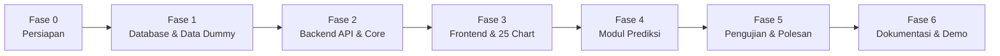
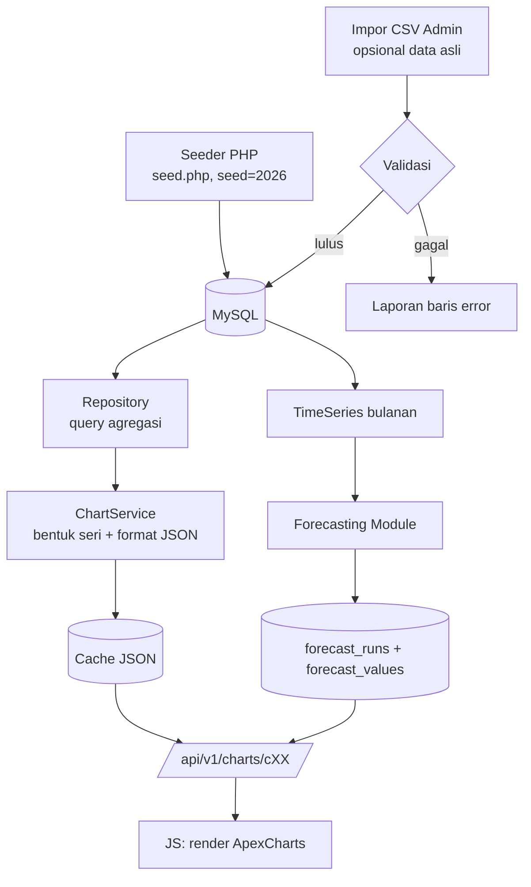
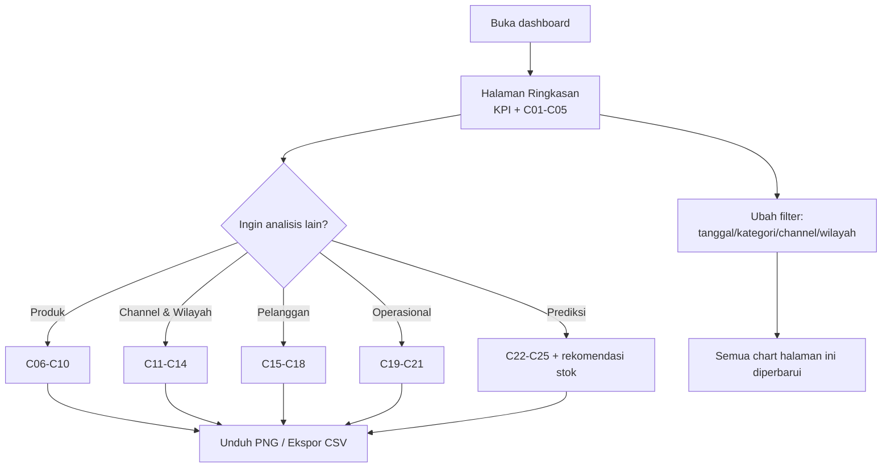
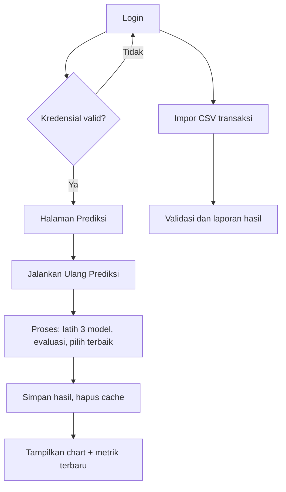
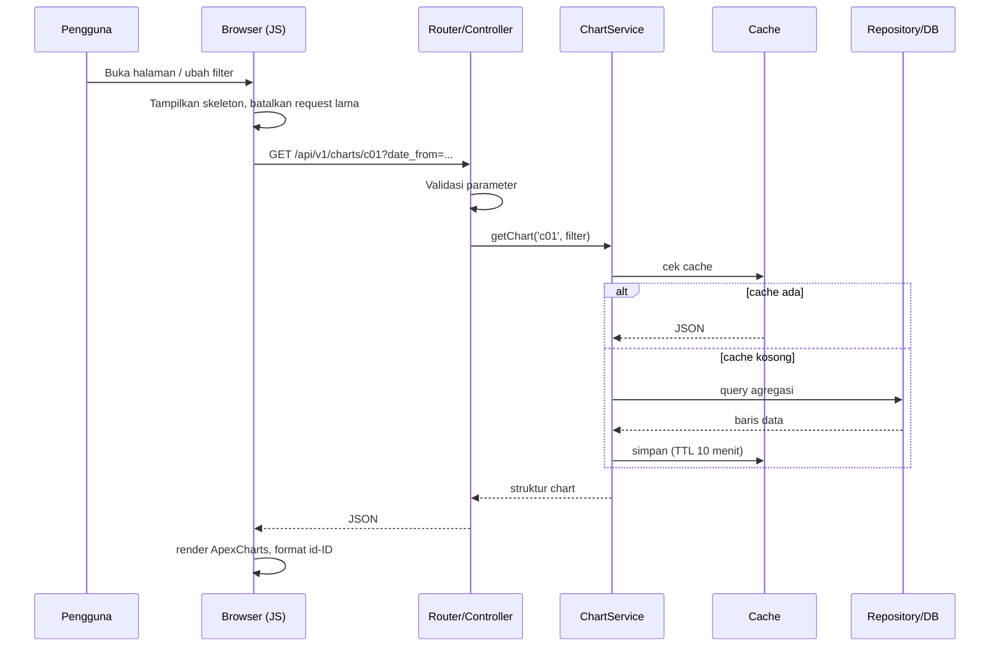
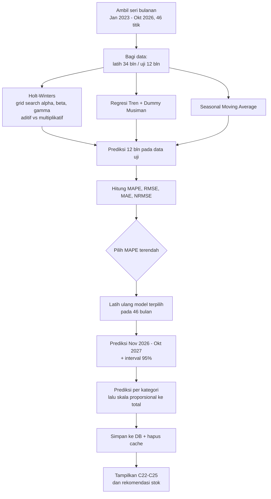
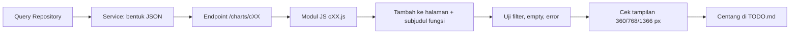

# WORKFLOW — EbonyCraft Palu

Dokumen alur kerja: alur pengembangan, alur data, alur pengguna, alur prediksi, serta aturan kerja tim (Git, QA, rilis, demo). Daftar tugas rinci ada di `TODO.md`.

---

## 1. Alur Pengembangan (Fase)

| Fase | Tujuan | Keluaran utama | Perkiraan (hari kerja) |
|------|--------|----------------|------------------------|
| 0. Persiapan | Lingkungan dan kerangka proyek siap | Repo, struktur folder, `composer.json`, `.env`, vhost | 1 |
| 1. Database & data dummy | Skema dan data realistis tersedia | `schema.sql`, seeder, validasi seeder lulus | 3 |
| 2. Backend API & Core | Semua endpoint data berfungsi | Router, repository, service, 25 endpoint chart, KPI, filter | 4 |
| 3. Frontend & 25 chart | Dashboard 6 halaman tampil | Layout, token desain, 25 modul chart, filter global | 5 |
| 4. Modul prediksi | Tiga model + evaluasi + halaman prediksi | `Forecasting/*`, `bin/forecast.php`, C22–C25, rekomendasi | 4 |
| 5. Pengujian & polesan | Mutu dan stabilitas | Unit test, UAT, perbaikan UI, aksesibilitas, performa | 3 |
| 6. Dokumentasi & demo | Siap dinilai | README, laporan, skrip demo, rehearsal | 2 |
| **Total** | | | **± 22 hari kerja** (sesuaikan dengan tenggat dosen) |

**Urutan kerja yang disarankan:** kerjakan secara *vertical slice*: selesaikan 1 chart penuh (database → API → UI) lebih dulu (C01) sebagai pola, lalu gandakan polanya ke 24 chart lainnya.

## 2. Alur Data (End-to-End)

**Aturan:** data mentah → agregasi di SQL → pembentukan seri di Service → render di browser. Browser tidak pernah menghitung agregasi besar. Cache dihapus setiap kali seeder, impor, atau prediksi selesai.

## 3. Alur Pengguna

### 3.1 Pemilik / Dosen (pengunjung publik)

### 3.2 Admin

## 4. Alur Permintaan Satu Chart

## 5. Alur Prediksi

**Cara menjalankan:** otomatis sekali setelah seeder (`bin/forecast.php`), atau manual lewat tombol admin / CLI `php bin/forecast.php`.

## 6. Alur Git dan Kolaborasi

| Aspek | Aturan |
|-------|--------|
| Cabang | `main` (stabil), `develop` (integrasi), `feature/<nama>` (mis. `feature/c01-trend`, `feature/forecast-hw`) |
| Commit | Format *Conventional Commits*: `feat:`, `fix:`, `docs:`, `test:`, `refactor:`, `chore:` |
| Pull request | Wajib deskripsi, tangkapan layar (untuk UI), dan daftar uji yang dijalankan |
| Merge | Dari `feature/*` ke `develop` setelah tinjauan; `develop` ke `main` saat akhir fase |
| Tag rilis | `v0.1` (data+API), `v0.5` (25 chart), `v1.0` (final) |
| Terlarang | Mengunggah `.env`, `vendor/`, `storage/cache/`, dan data pribadi |

## 7. Alur Pengerjaan Satu Chart (Definition of Done)

**Chart dianggap selesai bila:**
1. Endpoint mengembalikan JSON sesuai format baku dan merespons filter.
2. Visual sesuai spesifikasi `DESIGN.md` bagian 5.
3. Judul, subjudul fungsi, tooltip `id-ID`, serta menu unduh PNG/CSV tersedia.
4. Skeleton, empty state, dan error state teruji.
5. Angkanya cocok dengan hitungan manual/query pembanding pada minimal 1 periode.

## 8. Alur Pengujian dan QA

| Tahap | Kegiatan | Penanggung jawab | Kriteria lulus |
|-------|----------|------------------|----------------|
| 1. Unit | `vendor/bin/phpunit` (metrik, model, utilitas) | Pengembang | 100% lulus |
| 2. Validasi data | Skrip validasi seeder | Pengembang | Semua cek bagian 6.4 `ARCHITECTURE.md` lulus |
| 3. API | Uji 25 endpoint + kasus filter kosong/tidak valid | Pengembang | Format sah, status HTTP benar |
| 4. Rekonsiliasi angka | Bandingkan total chart dengan query SQL langsung | Pengembang | Selisih 0 (atau pembulatan) |
| 5. UAT | Telusuri 25 chart di 4 ukuran layar | Pengembang + teman penguji | Daftar periksa `TODO.md` terisi |
| 6. Keamanan dasar | Uji SQLi/XSS sederhana, CSRF, akses admin tanpa login | Pengembang | Semua ditolak sebagaimana mestinya |
| 7. Performa | Waktu muat halaman dan API | Pengembang | < 3 dtk halaman, < 500 ms API (cache hangat) |

**Penanganan bug:** catat → beri label (*blocker/major/minor*) → perbaiki di `feature/fix-*` → uji ulang → tutup.

## 9. Alur Rilis dan Serah Terima

1. Bekukan fitur (*feature freeze*) 3 hari sebelum tenggat.
2. Jalankan seluruh uji; perbaiki *blocker* dan *major*.
3. Reset ke kondisi bersih: buat DB baru → `schema.sql` → seeder → forecast.
4. Tag `v1.0`, ekspor basis data (`dump.sql`) sebagai cadangan.
5. Siapkan paket: kode sumber, `dump.sql`, `README`, lima dokumen `.md`, tangkapan layar semua halaman.
6. Uji di komputer lain (atau instal ulang bersih) mengikuti `README` untuk memastikan berjalan.

## 10. Skrip Demo ke Dosen (± 10 menit)

| Menit | Konten | Pesan kunci |
|-------|--------|-------------|
| 0–1 | Latar belakang UMKM Sumber Urip Ebony dan masalahnya | Mengapa dashboard dibutuhkan |
| 1–2 | Penjelasan data simulasi dan alasannya | Transparan; dapat diganti data asli |
| 2–4 | Ringkasan (C01–C05) + demo filter | Tren, musiman, hari ramai |
| 4–5 | Produk (C06–C10) | Pareto dan produk bintang |
| 5–6 | Channel & wilayah (C11–C14) | Pergeseran ke online |
| 6–7 | Pelanggan & operasional (C15–C21) | Loyalitas, biaya, stok, lead time |
| 7–9 | **Prediksi (C22–C25)**: metode, perbandingan model, akurasi, interval, rekomendasi | Inti judul: **prediksi** penjualan |
| 9–10 | Penutup: manfaat, keterbatasan, pengembangan lanjutan | Jujur terhadap keterbatasan |

**Pertanyaan yang mungkin diajukan dosen dan jawaban singkat:**
- *Mengapa Holt-Winters?* Data bulanan dengan tren dan musiman jelas; model ini dirancang untuk pola itu, transparan, dan cocok untuk data kecil.
- *Mengapa bukan LSTM/deep learning?* 46 titik data terlalu sedikit; risiko *overfitting* dan sulit dijelaskan.
- *Bagaimana tahu prediksi akurat?* Diuji pada 12 bulan terakhir yang tidak dipakai melatih; dilaporkan MAPE/RMSE/MAE dan dibandingkan dengan dua model lain.
- *Datanya asli?* Simulasi; skema dan impor CSV sudah disiapkan untuk data asli.
- *Bagaimana jika data asli polanya berbeda?* Model dilatih ulang otomatis dan dipilih ulang berdasarkan akurasi.

## 11. Rutinitas Kerja Harian (Disarankan)

1. Tarik cabang `develop` terbaru; pilih 1–2 tugas dari `TODO.md`.
2. Kerjakan di `feature/*`, commit kecil dan sering.
3. Jalankan `phpunit` dan cek manual chart yang diubah sebelum PR.
4. Perbarui centang di `TODO.md` dan catat kendala.
5. Akhir hari: *push* dan catat rencana esok hari.

## 12. Manajemen Risiko dalam Alur Kerja

| Pemicu | Tindakan |
|--------|----------|
| Fase tertinggal > 2 hari | Pangkas fitur *Could* (skenario, mode gelap), pertahankan *Must* |
| Satu chart bermasalah teknis | Gunakan tipe fallback (mis. boxplot → bar rentang) dan catat di laporan |
| MAPE > 15% | Sesuaikan noise/parameter seeder atau rentang grid; jelaskan sebab dalam laporan |
| Cache membuat data lama tampil | Hapus `storage/cache/*` atau jalankan `php bin/clear-cache.php` |
| Demo tanpa internet | Semua aset (ApexCharts, font lokal) sudah disalin ke `public/assets/` |
